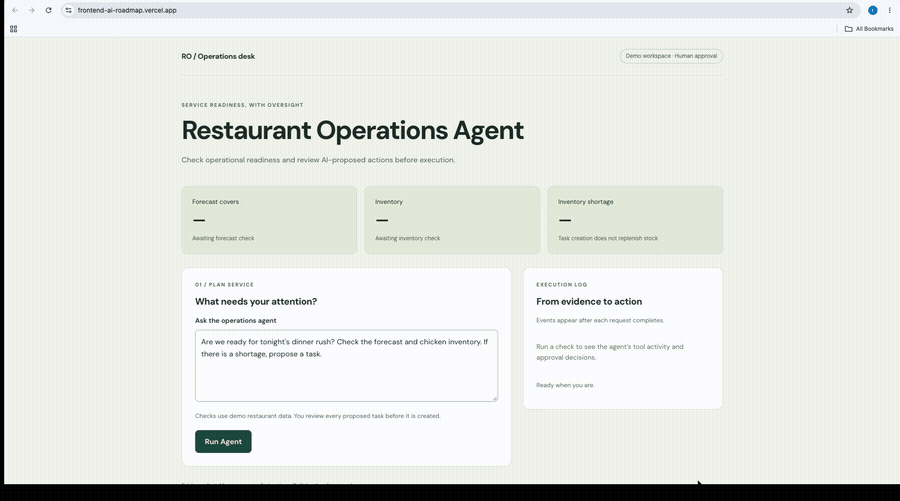
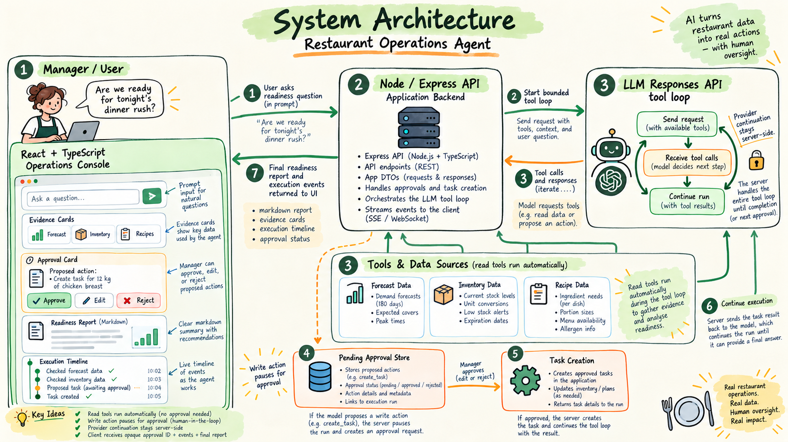
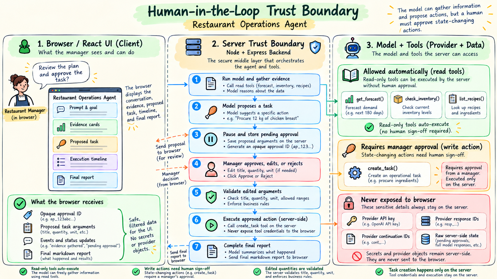
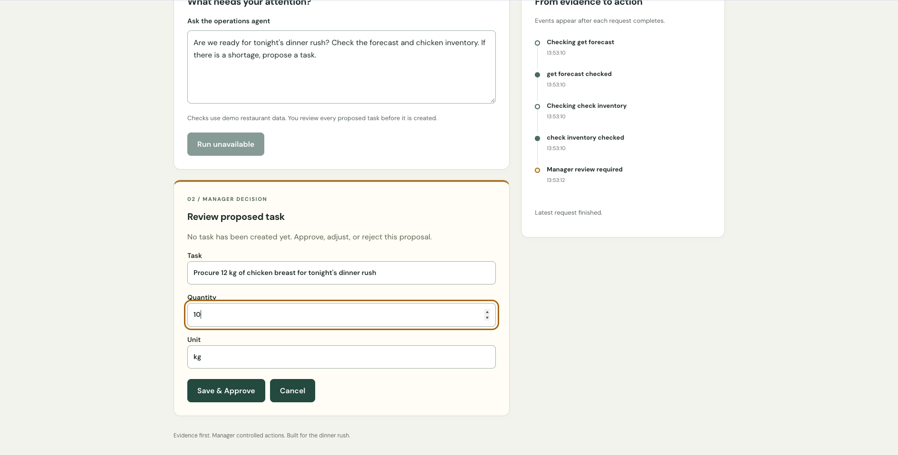
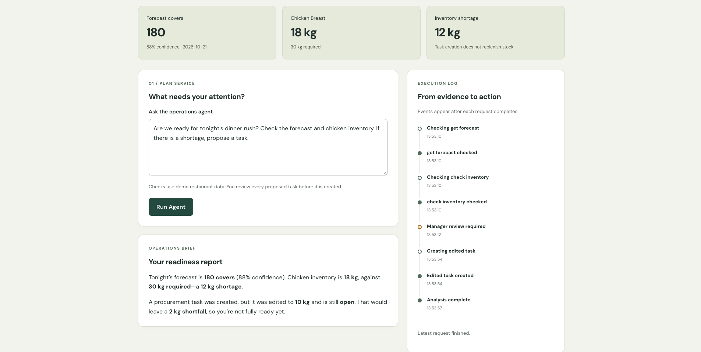
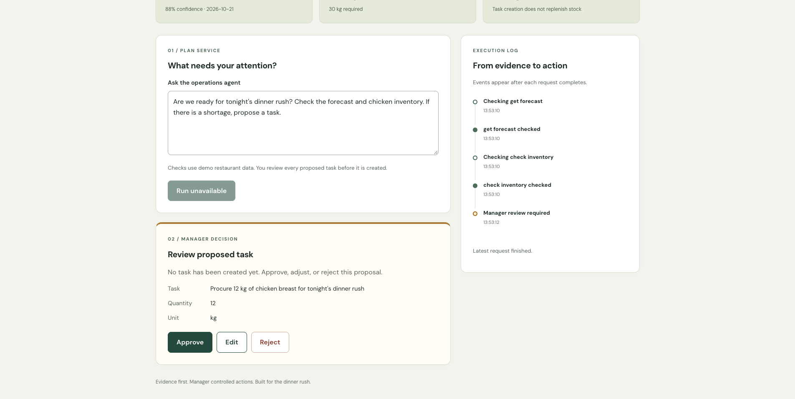
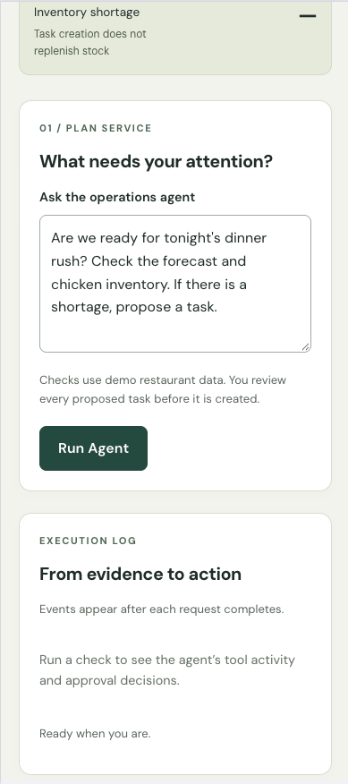

# 🍽️ Restaurant Operations Agent

A deployed React + TypeScript AI operations application that helps restaurant managers evaluate service readiness using **real application evidence, LLM reasoning, and human-approved actions**.

**Live Demo:**  
https://frontend-ai-roadmap.vercel.app/

**Backend API:**  
https://frontend-ai-roadmap.onrender.com/



---

## The Question

Restaurant operations often come down to a deceptively simple question:

> **“Are we ready for tonight’s dinner rush?”**

Answering it may require understanding:

- expected demand
- current inventory
- recipe requirements
- shortages
- actions needed before service

An LLM can help interpret that information.

But it shouldn’t invent the information.

And it shouldn’t be allowed to perform operational actions without control.

That is what this project explores.

---

## How It Works

The manager asks:

> **Are we ready for tonight's dinner rush?**

The agent uses deterministic application tools to inspect the restaurant state.

For the demo scenario:

```text id="l8mkcb"
Forecast
180 covers
88% confidence

Chicken inventory
18 kg available

Required inventory
30 kg

Shortage
12 kg
```

The model interprets those results and proposes:

> **Procure 12 kg of chicken breast**

But the task is **not created yet**.

The system pauses.

---

## 🏗️ System Architecture



The application separates the UI, application boundary, AI orchestration, deterministic tools, and state-changing operations.

The React client never receives:

- OpenAI API credentials
- provider response IDs
- provider tool-call IDs
- provider SDK objects

Provider-specific continuation state stays behind the Express API.

The browser receives only application-level DTOs and an opaque `approvalId`.

---

## ✋ Human in the Loop

Before a state-changing action can execute, the manager must decide.



The manager can:

✅ **Approve**  
✏️ **Edit + approve**  
❌ **Reject**

For example, the model may propose:

```text id="k6ouwh"
12 kg chicken
```

The manager can change it to:

```text id="nn0gox"
10 kg chicken
```



Only the approved **10 kg** action executes.

The agent then resumes with the actual result and reports:

```text id="4yl4sq"
Original shortage    12 kg
Approved task        10 kg
Remaining gap         2 kg
```



The model’s original proposal is not treated as authoritative.

The manager’s decision is.

---

## 🧠 The Core Idea

> **The model proposes.  
> The application validates.  
> The manager decides.  
> The system executes.**

The trust boundary is intentional:

- AI is used for interpretation, planning, and explanation.
- deterministic code owns calculations and business rules.
- humans approve state-changing actions.
- execution happens only after validation.

---

## 🧰 Deterministic Tools

The agent currently works with tools for:

```text id="wz94lv"
get_forecast
check_inventory
list_recipes
create_task
```

Read-only tools can execute automatically.

State-changing tools cannot.

---

## Why Deterministic Tools Matter

Critical business calculations stay in application code.

For example:

```ts id="mp13do"
const shortage = Math.max(required - available, 0);
```

The model does not calculate or invent that value.

It receives the result and interprets it.

### LLM responsibilities

```text id="kkosby"
interpretation
planning
tool selection
natural-language explanation
```

### Application responsibilities

```text id="ihse56"
calculations
validation
state mutation
business rules
security boundaries
execution
```

This separation reduces the amount of trust placed in probabilistic model output.

---

## 🔄 Bounded Agent Execution

The application uses a multi-step tool loop.

```text id="q9g1dm"
User goal
   ↓
Model selects tool
   ↓
Application executes tool
   ↓
Tool result returned
   ↓
Model reasons again
   ↓
More tools if needed
   ↓
Final response
```

The loop has a maximum-step guard to prevent uncontrolled execution.

---

## 📜 Structured Execution Timeline

The UI doesn’t expose raw provider events.

Instead, the server produces application-level domain events.

Examples include:

```text id="zz96k1"
tool_started
tool_completed
approval_required
decision
completed
error
```

These events produce a visible execution history such as:

```text id="s0ljd2"
Checking forecast
      ↓
Forecast checked
      ↓
Checking inventory
      ↓
Inventory checked
      ↓
Manager review required
      ↓
Edited task created
      ↓
Analysis complete
```

This lets the user understand **what happened and why**.

The current implementation returns events with API responses rather than streaming them live.

The same event model could later support SSE without redesigning the frontend domain model.

---

## 📊 Evidence, Not Parsed Model Text

The readiness cards come from structured tool results.

The UI does not scrape values out of generated LLM text.

Current evidence includes:

- forecast covers
- forecast confidence
- inventory available
- inventory required
- shortage

This also preserves an important domain distinction:

> **Creating a restock task does not mean the inventory has already arrived.**

If the restaurant has 18 kg against a requirement of 30 kg, the inventory shortage remains 12 kg even after a procurement task is created.

---

## 🖥️ Frontend Experience

Built with:

- React
- TypeScript
- Vite

The UI includes:

- manager prompt
- readiness cards
- tool-backed evidence
- editable approval workflow
- Markdown reports
- loading states
- error handling
- execution timeline
- responsive layouts
- keyboard-accessible controls
- quantity validation

### Manager approval



### Responsive mobile experience



---

## 🔐 Trust & Safety Boundaries

The backend owns:

- provider credentials
- agent orchestration
- tool execution
- pending approvals
- validation
- API contracts
- provider continuation state

The application also includes:

- restricted production CORS
- per-IP API rate limiting
- runtime validation
- bounded agent execution
- server-only secrets

The OpenAI API key never reaches the browser.

---

## 🚦 Rate Limiting

Public AI endpoints are protected with per-IP rate limiting to reduce accidental or abusive API usage.

The current limiter is intended for portfolio/demo protection.

For a distributed production system, rate-limit state would move to shared infrastructure rather than remaining instance-local.

---

## 🧪 Verified HITL Scenarios

### Approve

```text id="ykrm0y"
12 kg shortage
      ↓
Agent proposes 12 kg task
      ↓
Manager approves
      ↓
12 kg open task created
```

### Reject

```text id="2c0m07"
12 kg shortage
      ↓
Agent proposes task
      ↓
Manager rejects
      ↓
No task created
      ↓
Shortage remains unresolved
```

### Edit + Approve

```text id="jyf3n9"
12 kg shortage
      ↓
Agent proposes 12 kg
      ↓
Manager edits → 10 kg
      ↓
10 kg task created
      ↓
Agent resumes
      ↓
2 kg remaining gap reported
```

All three paths have been exercised through the deployed browser application.

---

## 🧱 Tech Stack

### Client

- React
- TypeScript
- Vite

### Server

- Node.js
- TypeScript
- Express

### AI

- OpenAI Responses API
- Tool/function calling
- bounded agent loop
- structured tool schemas

### Deployment

- Vercel — frontend
- Render — backend

---

## 📁 Repository Structure

```text id="5w4336"
restaurant-operations-agent/
│
├── client/
│   └── src/
│       ├── api/
│       ├── components/
│       ├── tests/
│       ├── types/
│       └── App.tsx
│
├── server/
│   └── src/
│       ├── ai/
│       ├── approvals/
│       ├── data/
│       ├── tests/
│       ├── tools/
│       └── index.ts
│
├── docs/
│   └── media/
│       ├── demo.gif
│       ├── approval-required.png
│       ├── edit-approval.png
│       ├── completed-outcome.png
│       ├── mobile.png
│       ├── restaurant_operations_agent_architecture.png
│       └── human_in_the_loop_trust_boundary.png
│
└── README.md
```

---

## ▶️ Run Locally

Use Node.js 22 or newer.

### Server

```bash id="iy9zjf"
cd server
npm ci
```

Create:

```text id="8u50t7"
server/.env
```

Add:

```env id="h5ty4q"
OPENAI_API_KEY=your_api_key
OPENAI_MODEL=your_model
```

Then:

```bash id="zqskt4"
npm run dev
```

The API defaults to:

```text id="p1246l"
http://localhost:3001
```

---

### Client

In another terminal:

```bash id="ck8zv9"
cd client
npm ci
npm run dev
```

The frontend defaults to:

```text id="pi0lw3"
http://localhost:3001
```

for the API.

To use another backend:

```env id="449ldp"
VITE_API_URL=https://your-api.example.com
```

Never expose provider credentials using Vite environment variables.

---

## ☁️ Deployment

### Frontend

Hosted on Vercel:

https://frontend-ai-roadmap.vercel.app/

Production configuration:

```env id="ehapjb"
VITE_API_URL=https://frontend-ai-roadmap.onrender.com
```

### Backend

Hosted on Render:

https://frontend-ai-roadmap.onrender.com/

Server-side environment configuration includes:

```text id="pderq5"
OPENAI_API_KEY
OPENAI_MODEL
CLIENT_ORIGIN
```

Production client origin:

```text id="6tvumk"
https://frontend-ai-roadmap.vercel.app
```

---

## ✅ Validation

### Client

```bash id="6gctez"
cd client

npm run build
npm run lint
npm test
```

### Server

```bash id="r36gyi"
cd server

npm run typecheck
npm run build
npm test
```

Automated tests cover frontend presentation behavior and server-side tool/event behavior.

Live provider integration requires valid provider credentials and incurs API usage.

---

## ⚠️ Current Limitations

This is a portfolio/demo system rather than a production restaurant platform.

Current limitations include:

- synthetic restaurant data
- fixed demo forecast
- tasks stored in process memory
- pending approvals stored in process memory
- server restart clears application state
- no authentication
- no role-based authorization
- no durable audit history
- no multi-instance approval coordination
- no atomic approval claiming
- no write-operation idempotency
- no approval expiry
- no durable provider-failure recovery
- no persistent streaming history

Rate limiting is currently instance-local rather than backed by shared distributed storage.

---

## 🚫 Intentionally Not Added

This milestone does not include:

- RAG
- LangGraph
- MCP
- multi-agent orchestration

That is intentional.

The project isn’t designed to accumulate AI framework keywords.

Those technologies should be added only when they solve a real product requirement.

---

## 🔭 What I’d Add Next

For a production version:

- durable task + approval storage
- authentication
- role-based authorization
- approval expiry
- idempotency
- atomic approval claims
- distributed rate limiting
- durable audit history
- SSE live execution events
- cancellation + reconnection
- AI evaluation scenarios
- prompt-injection testing
- provider abstraction
- observability + tracing
- real restaurant data integrations

---

## The Principle Behind the Project

The most important lesson from this build is not about a particular LLM or framework.

It is about deciding **where AI should have authority — and where it should not.**

```text id="dkv92p"
AI
→ understand
→ reason
→ propose

Application
→ validate
→ enforce rules

Human
→ approve trusted actions

System
→ execute
```

That separation is the architecture.