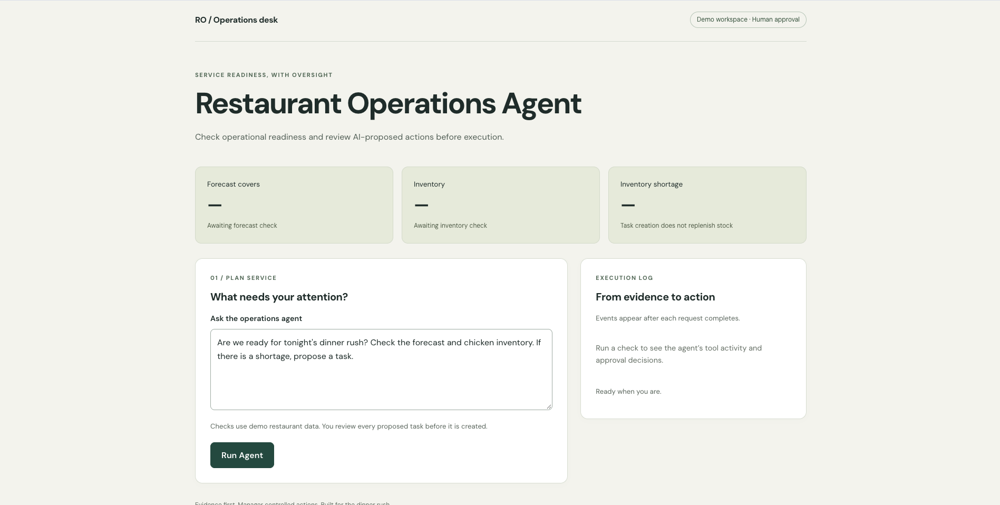

# Restaurant Operations Agent

A deployed React + TypeScript AI operations application that combines deterministic restaurant data with LLM tool calling, structured execution events, and human approval for state-changing actions.

**Live Demo:** https://frontend-ai-roadmap.vercel.app/  
**API:** https://frontend-ai-roadmap.onrender.com

> Built as a portfolio project to demonstrate AI-native frontend/product engineering: grounded tool use, bounded agent execution, human-in-the-loop controls, provider isolation, and transparent execution history.

---

## Overview

The Restaurant Operations Agent helps a restaurant manager evaluate service readiness using operational evidence rather than relying on an LLM to invent business state.

For the demo scenario, the agent:

1. Retrieves the expected dinner-service forecast.
2. Checks chicken inventory.
3. Identifies inventory shortages using deterministic application logic.
4. Proposes an operational task when action is required.
5. Pauses before any state-changing action.
6. Allows the manager to **Approve**, **Edit**, or **Reject** the proposal.
7. Resumes the agent with the actual manager decision and executed outcome.

The model can reason about operational evidence, but the application retains control over business logic and side effects.

---

## Demo


The demo shows the full flow:

1. Agent checks forecast and inventory.
2. Detects a 12 kg chicken shortage.
3. Proposes a task.
4. Manager edits the task from 12 kg to 10 kg.
5. The approved task executes.
6. The final report correctly identifies the remaining 2 kg shortfall.

## Screenshots



### Human approval before execution


### Editable AI proposal


### Grounded final outcome


### Responsive UI


A short end-to-end demo recording is available in:

`docs/media/demo.mov`

The demo shows the full flow:

```text
Manager question
      ↓
Forecast + inventory tools
      ↓
12 kg chicken shortage
      ↓
AI proposes operational task
      ↓
Manager edits 12 kg → 10 kg
      ↓
Approved task executes
      ↓
Agent resumes
      ↓
Final report identifies remaining 2 kg shortfall
```

---

## What It Demonstrates

- Tool-grounded AI recommendations using deterministic forecast and inventory data
- LLM function/tool calling
- Bounded multi-step agent execution
- Separation of probabilistic reasoning from deterministic business logic
- Human-in-the-loop approval for write operations
- Approve, reject, and edit-before-execution workflows
- Structured application-level execution events
- Evidence and decision timeline
- Server-side provider isolation
- Responsive React operations console
- Runtime validation of edited actions
- Safe Markdown rendering
- Frontend and domain-level automated tests
- Public deployment using Vercel and Render
- Per-IP rate limiting for public AI endpoints

---

## Architecture

```text
┌─────────────────────────────┐
│ React Operations Console    │
│ Vercel                      │
└──────────────┬──────────────┘
               │ HTTPS / JSON
               ▼
┌─────────────────────────────┐
│ Node / Express API          │
│ Render                      │
│                             │
│ • API DTO boundary          │
│ • approvalId management     │
│ • provider credentials      │
│ • validation                │
└──────────────┬──────────────┘
               │
               ▼
┌─────────────────────────────┐
│ Agent Orchestrator          │
│                             │
│ bounded multi-step loop     │
└─────────┬───────────┬───────┘
          │           │
          ▼           ▼
   ┌────────────┐  ┌────────────────────┐
   │ LLM        │  │ Deterministic Tools│
   │            │  │                    │
   │ reasoning  │  │ • get_forecast     │
   │ planning   │  │ • check_inventory  │
   │ tool choice│  │ • list_recipes     │
   └────────────┘  │ • create_task      │
                   └─────────┬──────────┘
                             │
                             ▼
                   ┌────────────────────┐
                   │ Human Approval     │
                   │                    │
                   │ Approve            │
                   │ Edit + Approve     │
                   │ Reject             │
                   └────────────────────┘
```

The React client never receives OpenAI response IDs, tool-call IDs, API credentials, or provider SDK objects.

Provider-specific continuation state remains on the server and is exposed to the browser only through an opaque application-level `approvalId`.

---

## Agent Execution Model

The project deliberately separates **model reasoning** from **application execution**.

```text
User goal
   ↓
LLM decides which information is required
   ↓
Tool request
   ↓
Application executes deterministic function
   ↓
Tool result returned to model
   ↓
Model continues reasoning
   ↓
Possible additional tool request
   ↓
Final response
```

The agent loop is bounded to a maximum number of steps to prevent uncontrolled execution.

---

## Deterministic Business Logic

The LLM is not responsible for calculating critical operational facts.

For example, inventory shortage is calculated by application code:

```ts
shortage = Math.max(required - available, 0);
```

The LLM receives this grounded result and interprets what it means operationally.

This keeps responsibilities clear:

```text
LLM
→ interpretation
→ planning
→ tool selection
→ natural-language explanation

Application code
→ calculations
→ validation
→ authorization boundaries
→ state mutation
→ trusted business rules
```

---

## Human-in-the-Loop Trust Boundary

Read-only tools execute automatically.

Examples:

```text
get_forecast
check_inventory
list_recipes
```

State-changing tools do not execute directly when requested by the model.

For example:

```text
LLM requests create_task
        ↓
Application intercepts request
        ↓
Pending approval created
        ↓
Manager reviews proposal
     ↙        ↓        ↘
 Approve     Edit     Reject
     ↓        ↓        ↓
Execute    Execute    No mutation
           edited
           version
```

The model proposes an action.

The application and manager retain execution authority.

### Approval states and task states are separate

An approved action can create a task whose operational lifecycle status is still `open`.

For example:

```text
Approval state
approved_and_executed

Task lifecycle state
open
```

This avoids confusing “open task” with “awaiting approval”.

---

## Structured Execution Events

The application records domain-level execution events rather than exposing provider-specific events to React.

Current event types include:

```text
tool_started
tool_completed
approval_required
decision
completed
error
```

The UI converts those events into an execution timeline such as:

```text
Checking get forecast
        ↓
get forecast checked
        ↓
Checking check inventory
        ↓
check inventory checked
        ↓
Manager review required
        ↓
Creating edited task
        ↓
Edited task created
        ↓
Analysis complete
```

This creates a transparent evidence → decision → action history for the user.

The event model is transport-independent. The current implementation returns events with API responses rather than streaming them live.

A future SSE transport can emit the same event DTOs without redesigning the frontend domain model.

---

## Evidence Cards

The UI presents structured tool results directly.

Current evidence includes:

- Forecast covers
- Forecast confidence
- Chicken inventory
- Required inventory
- Inventory shortage

The application does **not** parse these values from generated model text.

The evidence cards come from structured deterministic tool results.

This also preserves an important business distinction:

> Creating a restock task does not immediately replenish inventory.

If inventory is 18 kg and the requirement is 30 kg, the shortage remains 12 kg even after an operational task is created.

---

## Example HITL Scenario

Initial evidence:

```text
Forecast
180 covers
88% confidence

Chicken inventory
18 kg available

Required
30 kg

Shortage
12 kg
```

The agent proposes:

```text
Procure 12 kg of chicken breast
```

The manager edits the proposal:

```text
12 kg → 10 kg
```

The application executes the approved 10 kg task.

The model then receives the actual executed outcome and correctly reports:

```text
Original shortage: 12 kg
Approved task:      10 kg
Remaining gap:       2 kg
```

This demonstrates that human-approved values are authoritative rather than the model's original proposal.

---

## Frontend

Built with:

- React
- TypeScript
- Vite

The operations console includes:

- Manager prompt input
- Tool-backed readiness cards
- Loading and error states
- Human approval interface
- Editable proposals
- Markdown operations report
- Execution timeline
- Responsive desktop/mobile layout
- Keyboard-accessible controls
- Quantity validation

The UI has been verified at desktop width and approximately 390 px mobile width.

---

## Backend

Built with:

- Node.js
- TypeScript
- Express
- OpenAI Responses API

The backend owns:

- Agent orchestration
- Tool execution
- Provider credentials
- Provider continuation state
- Pending approvals
- Runtime validation
- App-level event generation
- API contracts
- CORS policy

The deployed API accepts requests only from the configured production client origin and approved local development origins.

---

## Repository Structure

```text
restaurant-operations-agent/
├── client/
│   └── src/
│       ├── api/
│       ├── components/
│       ├── tests/
│       ├── types/
│       └── App.tsx
│
├── server/
│   └── src/
│       ├── ai/
│       ├── approvals/
│       ├── data/
│       ├── tests/
│       ├── tools/
│       └── index.ts
│
├── docs/
│   └── media/
│
└── README.md
```

---

## Run Locally

Use Node.js 22 or newer.

### Backend

```sh
cd server
npm ci
```

Create:

```text
server/.env
```

with:

```env
OPENAI_API_KEY=your_api_key
OPENAI_MODEL=your_model
```

Then:

```sh
npm run dev
```

The API defaults to:

```text
http://localhost:3001
```

`PORT` can be used to configure another server port.

---

### Frontend

In another terminal:

```sh
cd client
npm ci
npm run dev
```

Open the Vite URL printed in the terminal.

By default, the frontend connects to:

```text
http://localhost:3001
```

To use another API:

```env
VITE_API_URL=https://your-api.example.com
```

Never place provider credentials such as `OPENAI_API_KEY` in a Vite environment variable.

---

## Deployment

### Frontend

Hosted on **Vercel**:

https://frontend-ai-roadmap.vercel.app/

The deployed client uses:

```env
VITE_API_URL=https://frontend-ai-roadmap.onrender.com
```

### Backend

Hosted on **Render**:

https://frontend-ai-roadmap.onrender.com

Server-side environment configuration includes:

```text
OPENAI_API_KEY
OPENAI_MODEL
CLIENT_ORIGIN
```

`CLIENT_ORIGIN` is configured as:

```text
https://frontend-ai-roadmap.vercel.app
```

The OpenAI API key never reaches the browser.

---

## Validation

### Client

```sh
cd client

npm run build
npm run lint
npm test
```

### Server

```sh
cd server

npm run typecheck
npm run build
npm test
```

The current automated suites cover frontend presentation/domain behavior and server-side tool/event behavior.

Live provider integration requires valid API credentials and incurs API usage.

---

## Acceptance Scenarios

### Approve

```text
Agent detects 12 kg shortage
→ proposes 12 kg task
→ manager approves
→ 12 kg open task created
```

### Reject

```text
Agent detects 12 kg shortage
→ proposes task
→ manager rejects
→ no task created
→ shortage remains unresolved
```

### Edit + Approve

```text
Agent detects 12 kg shortage
→ proposes 12 kg task
→ manager edits quantity to 10 kg
→ 10 kg task created
→ final report identifies remaining 2 kg gap
```

The deployed browser application has been exercised across all three flows.

---

## Current Limitations

This is a portfolio/demo system rather than a production restaurant platform.

Current limitations include:

- Forecast and restaurant records use synthetic fixture data
- The forecast currently contains a fixed demo date
- Tasks live in process memory
- Pending approvals live in process memory
- Server restart clears application state
- No user authentication
- No role-based authorization
- No durable audit/event history
- No multi-instance approval coordination
- No atomic approval claiming
- No write-operation idempotency
- No approval expiry
- No provider-failure recovery workflow
- No durable SSE event history
- Streaming events are not yet enabled
- RAG is intentionally not included
- LangGraph is intentionally not included
- MCP is intentionally not included
- Multi-agent orchestration is intentionally not included
- Rate limiting is currently application-instance/in-memory based and is intended for portfolio/demo abuse protection rather than distributed production enforcement

Before exposing production write operations, the system would need durable persistence, authentication/authorization, idempotency, concurrency controls, approval expiry, recovery mechanisms, and stronger abuse protection.

---

## Why These Features Were Intentionally Deferred

The goal of this project is not to collect AI framework names.

The architecture focuses on one core principle:

> Use probabilistic AI for interpretation and planning while deterministic application code and humans retain authority over trusted business operations.

Features such as RAG, LangGraph, MCP, multi-agent orchestration, and durable streaming would only be added when they solve a concrete product requirement.

---

## Future Improvements

Potential next steps:

- Durable task and approval storage
- Approval expiry
- Idempotency and atomic approval claims
- Authentication and role-based permissions
- Shared/distributed rate-limit storage and stronger API-budget enforcement
- Durable execution history
- SSE-based live execution events
- Cancellation and reconnect support
- AI evaluation scenarios
- Prompt-injection testing
- Provider abstraction for multiple LLM vendors
- Real operational data integrations
- Production observability and tracing

---

## Key Engineering Takeaway

The project intentionally avoids treating the LLM as an authority.

```text
Evidence
   ↓
LLM reasoning
   ↓
Proposed action
   ↓
Application trust boundary
   ↓
Human decision
   ↓
Deterministic execution
   ↓
Actual outcome returned to model
```

The model can recommend.

The application validates.

The manager decides.

The system executes.

---

## Portfolio Positioning

This project demonstrates the transition from traditional frontend/product engineering into AI-native application development while retaining strong frontend architecture and user-experience principles.

It combines:

```text
React / TypeScript
+
API and application architecture
+
LLM tool calling
+
Agent orchestration
+
Human-in-the-loop UX
+
Deterministic business logic
+
Trust boundaries
+
Testing
+
Deployment
```